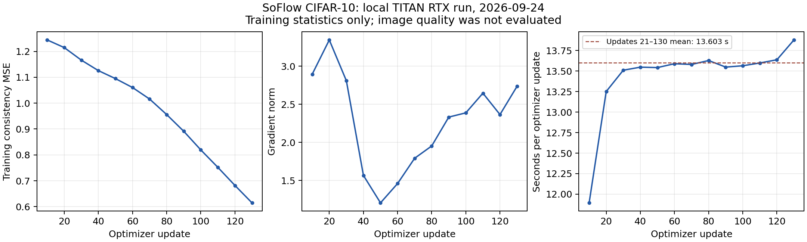

# Experiment report: SoFlow CIFAR-10 trainability and local training feasibility

**Experiment:** SOFLOW-CIFAR10-TITAN-2026-09-24  
**Date/time zone:** 2026-09-24, Asia/Seoul (KST, UTC+09:00)  
**Disposition:** Stopped by an authorized feasibility decision; full training incomplete  
**Execution checkout:** `/home/user/jw_soflow/SoFlow`  
**Canonical report:** `FastGen-SoFlow/docs/soflow-cifar10/EXPERIMENT_REPORT.md`

## 1. Executive finding

The adapted SoFlow CIFAR-10 pipeline **successfully executed training on one TITAN RTX**. Dataset loading, forward/backward computation, gradient accumulation, optimizer updates, EMA handling, and short-run checkpoint save/resume worked. The final production log confirms **130 optimizer updates**, with finite reported gradients and decreasing training consistency MSE.

The complete paper-scale schedule is **not practical within the current one-day development budget and measured configuration**. Sustained observed throughput was **13.603 seconds/update**, projecting to **125.95 days** for 800,000 updates, before periodic generation, checkpoint overhead, and interruptions. This is a resource-budget conclusion, not a claim that the model cannot finish training on this hardware.

**Image quality was not evaluated.** No generated sample grids or FID results were produced by the production run. The falling training loss establishes initial optimization behavior, not convergence, diversity, perceptual quality, or reproduction of the paper's results. Meaningful quality improvement within a day is **unestablished, not disproven**.

Under the user's conditional authorization, the run was stopped at **21:15:59 KST**. The latest recoverable main-run checkpoint is **step 5**; subsequent logged progress was not checkpointed. This distinction is essential when using the experiment's evidence.

## 2. Objective and scope

The initial objective was a full CIFAR-10 training run using the README/paper recipe, adapted to physical GPU 0. The user clarified that “single pass” meant one full experiment, without a hyperparameter search. Later, the user specifically authorized microbatch throughput tuning while retaining the effective batch size, followed by this feasibility review.

Questions addressed:

1. Can the local implementation load CIFAR-10 and execute its actual training path?
2. Which of the measured microbatches improves throughput within available GPU memory?
3. Is the full prescribed schedule practical on the assigned hardware?
4. What evidence supports continued training for a meaningful quality result within one day?

This experiment concerns **unconditional, pixel-space CIFAR-10 generation**. It is separate from Astra's conditioned 64×64 Pokémon/FastGen experiment on GPU 1. Its measurements cannot establish FastGen memory needs, optimal batch size, quality, or completion time. No new convergence or quality tests were run for this report; it analyzes retained training evidence.

## 3. Conditions and provenance

### Hardware and software

| Item | Condition |
|---|---|
| Assigned accelerator | One NVIDIA TITAN RTX, physical GPU 0 |
| Reported memory capacity | 24,576 MiB |
| Driver | 580.178.04 |
| Python environment | `/home/user/miniconda3/envs/soflow`, Python 3.10.21 |
| User-site isolation | `PYTHONNOUSERSITE=1` |
| PyTorch / torchvision | 2.7.1+cu126 / 0.22.1+cu126 |
| NumPy | 1.26.4 |
| Main training precision | FP32; no AMP; upstream EMA uses double-precision intermediates |
| Launch mode | One `torch.distributed.run` worker; `CUDA_VISIBLE_DEVICES=0` |
| Upstream Git revision | `cc47661a0b0843f8f1b6cff3a17107a052d18b21` |
| Local source state | Modified; archived training patch, scripts, config, and SHA-256 provenance accompany this report |

The `soflow` and `soflow_eval` environments were repaired by another agent before the production run used here. The initial pre-repair process was retired; a fresh process loaded Torch and torchvision from the conda environment. Environment qualification by that agent is supporting setup evidence, not a CIFAR quality measurement. The evaluation environment was available but was not used to score this run.

A pre-stop snapshot showed GPU 0 at **10,614 MiB, 99% utilization, and 87°C**. These are instantaneous observations, not a thermal-throttling diagnosis. Another experiment used GPU 1 during part of production training; shared-host activity and thermal conditions were not experimentally controlled.

### Data and model

- Dataset: official CIFAR-10 Python archive, downloaded from the University of Toronto; resumed download completed and torchvision's integrity checks permitted extraction/loading.
- Training split: 50,000 RGB images, resolution 32×32, ten classes. No test-split quality evaluation was performed.
- Input processing: tensors normalized from pixel values to approximately `[-1, 1]`; no VAE or latent preprocessing.
- Model: upstream unconditional SongUNet configured in `models.py`, approximately **55.93M parameters**. Base multiplier 128, channel multipliers `[2,2,2]`, four residual blocks per level, attention at resolution 16, dropout 0.30, and six augmentation-conditioning inputs.
- Augmentation: upstream `AugmentPipe(p=0.12, xflip=1e8, yflip=0, scale=1, rotate_frac=0, aniso=1, translate_frac=1)`. These are the implemented API settings, not literal image-flip probabilities.

### Training recipe

| Setting | Value |
|---|---|
| Training target | 800,000 optimizer updates |
| Effective batch | 1,024 images/update |
| Selected GPU microbatch | 64 images; 16 accumulation chunks/update |
| Optimizer | RAdam; learning rate 1e-4; betas `[0.9, 0.999]`; weight decay 0 |
| Loss | Consistency-only (`velocity_loss_ratio=0`); `p=0.75`; `eps=0.001` |
| Guidance | Disabled (`cfg_scale=1`, `cfg_drop_rate=0`, `mix_ratio=1`) |
| Noising / solution parameterization | Linear / Euler |
| Time sampling | Logit-normal; means `[−0.9, −4.0, −0.9]`, standard deviations `[1.6, 1.6, 1.6]`; velocity branch unused |
| Gap schedule | Exponential, from 1 to 1/3200 across 800,000 updates |
| EMA | Configured decay 0.9999; upstream CIFAR implementation refreshes every 16 updates using decay^16, including its initial refresh |
| Data loader | 12 workers; prefetch factor 6; shuffled distributed sampler; `drop_last=True` |
| Seed | 42 |
| Production logging after tuning | Every 10 updates, plus the first resumed update |
| Demo generation | 32 images every 1,000 updates |
| Checkpoint and FID sample generation | Every 25,000 updates; 50,000 generated images per sample set; metric evaluation separate |

The accumulation implementation transfers CPU batches in chunks, weights each chunk's loss by its share of the logical batch, and performs one optimizer update per 1,024 images. Scheduling and EMA counters advance on optimizer updates. Random-number ordering and upstream resume behavior prevent a claim of bitwise equivalence to the original multi-GPU execution.

## 4. Procedure and operational history

1. Prepared the single-GPU launcher and accumulation support. Corrected the device-selection variable to `CUDA_VISIBLE_DEVICES` and used the conda interpreter's module launcher.
2. Paused the original download/training process while another agent repaired the environments, then retired the stale process. Resumed the partial archive download and launched fresh with user-site packages disabled.
3. The first production launch completed an optimizer update at **20:22:35**, using microbatch 16. Only its initialization checkpoint was saved before the later tuning restart; its unsaved updates were lost.
4. Measured microbatches **16, 64, 128, and 256** using the actual training loop. Each successful candidate ran five optimizer updates at the unchanged 800,000-update schedule. Updates 1–2 were warmup; the median of updates 3–5 was the comparison statistic. All candidates used effective batch 1,024 and seed 42. Microbatch 256 exhausted memory.
5. Selected microbatch 64 and copied its five-update model/EMA/optimizer checkpoint into the main run. The production process loaded it at **20:47:01**; update 6 completed at **20:47:13**.
6. Logged production progress through update **130 at 21:15:09**. Stopped the run after the budget review by sending SIGTERM to its verified torchrun child at **21:15:59**.

The launcher exited with status **1 following intentional termination**. It is not evidence of a numerical failure in the selected configuration. Process inspection confirmed the launcher/torchrun exited and no GPU 0 compute process remained. The other experiment's processes were not signaled.

The running trainer did not support checkpoint-on-signal. Editing its source would not install a handler into the already-running process. The main run therefore retains checkpoints **0 and 5**, while the later loss trajectory survives in logs only. At least **125 logged updates beyond the recoverable checkpoint** were not saved; the exact in-memory step at termination was not logged. Do not label checkpoint 5 as checkpoint 130.

## 5. Results

### Microbatch comparison

| Microbatch | Chunks/update | Peak sampled device memory | Peak Torch allocation | Median seconds/update | Images/second |
|---|---:|---:|---:|---:|---:|
| 16 | 64 | 4,188 MiB | 3.34 GiB | 14.73 | 69.52 |
| **64** | **16** | **10,574 MiB** | **9.51 GiB** | **12.72** | **80.50** |
| 128 | 8 | 19,174 MiB | 17.74 GiB | 13.22 | 77.46 |
| 256 | 4 | 23,898 MiB before failure | No completed update | Out of memory | — |

Microbatch 64 was the fastest **among the tested settings**, with approximately **15.8% higher throughput** and **13.6% less time/update** than 16. Microbatch 128 occupied more memory but was slightly slower. Device memory was sampled once per second; Torch allocation came from `max_memory_allocated()`, divided by 1024³ even though the original log label says “GB.” Neither measurement is interchangeable with the other.

This was a short sequential comparison with one seed and three timed updates per successful candidate. No confidence intervals, randomized trial order, or exhaustive batch-size search were performed. The result supports choosing 64 locally, not declaring a universal optimum.

### Production training observations



| Observation | Result |
|---|---|
| First resumed update | Step 6; MSE 1.244692; gradient norm 2.676620; 11.70 seconds |
| First production logging window | Through step 10, five resumed updates; mean consistency MSE 1.24413 |
| Last complete logging window | Through step 130; mean consistency MSE 0.61469; gradient norm 2.73487 |
| Sustained timing window | Updates 21–130: 110 updates in 1,496.33 seconds |
| Mean sustained update time | **13.603 seconds** |
| Sustained image throughput | **75.28 images/second** |
| Production peak Torch allocation | **9.51 GiB** |
| Full-run completion | **No** |
| Generated quality samples / FID | **Not produced / not measured** |

The approximately 51% reduction between the first and last logged MSE averages is an observed training-statistic trend. The windows contain different data/noise draws and the objective includes changing loss weights and a time-gap schedule. It must not be interpreted as a 51% quality improvement. Finite updates and loss movement support **initial trainability under the measured conditions**, not guaranteed long-term stability or convergence.

## 6. Training scale and one-day feasibility

The paper specifies CIFAR-10 batch size 1,024 for 800K iterations and states that its experiments used H100 GPUs. It does not supply an explicit total CIFAR-10 runtime or GPU count for that experiment. Its efficiency table is insufficiently specified to transfer directly to this UNet run. See [Appendices A and D](https://arxiv.org/html/2512.15657v2) and the [detailed paper comparison](cifar10-training-cost.md).

The configured schedule processes:

```text
800,000 × 1,024 = 819,200,000 image presentations
819,200,000 / 50,000 = 16,384 equivalent complete dataset passes
floor(50,000 / 1,024) = 48 optimizer updates per loader epoch
800,000 / 48 ≈ 16,667 loader epochs
```

Using the sustained local measurement and excluding sampling/checkpoint overhead:

| Projection | Estimate |
|---|---:|
| One loader epoch | 10.88 minutes |
| Full 800,000-update schedule | **125.95 days** |
| Updates within 24 hours | **About 6,352** |
| Fraction of full schedule within 24 hours | **0.794%** |
| Equivalent dataset passes within 24 hours | About 130 |
| First scheduled demo at update 1,000 | **3.78 hours** |
| First scheduled checkpoint and FID sample set at update 25,000 | **3.94 days** |

The gap ratio is `r(k)=3200^(-k/800000)`. After approximately 6,352 updates it would still be about **0.938**, versus the endpoint **0.0003125**. This quantifies how early a one-day run is in the configured curriculum; it does **not** by itself establish how its images would look.

There could be visible quality improvement within a day, and approximately 130 equivalent dataset passes is real training. However, this experiment provides no generated-image evidence or predeclared quality threshold to justify that expectation. The default measurement cadence would provide demo grids within a day but no scheduled FID sample set. An earlier evaluation would require a separate explicitly bounded quality experiment. None was performed here.

**Decision:** stop the full-schedule run under the user's feasibility condition. The decision is based on the approximately 126-day completion cost and the absence of evidence for a decision-useful one-day quality result. It is not a claim that learning within one day is impossible. The initial execution/trainability objective has evidence; full paper reproduction and generation-quality objectives remain unmet.

## 7. Limitations and implications

- Full training, final sampling, and published FID reproduction were not completed. An exact reproduction claim is unsupported.
- The retained checkpoint is much earlier than the last observed loss. The process could not preserve its final in-memory weights on termination.
- The upstream checkpoint format used here does not retain RNG/data-loader position. Restarts repeat part of a recorded epoch and do not reproduce an uninterrupted trajectory exactly.
- Timing estimates assume comparable future throughput. Longer-term thermals, shared host load, evaluation, and interruptions can change elapsed time. Short tuning medians were more optimistic than the later production window.
- The intentionally failed 256-image measurement establishes a memory limit for that attempted configuration, not a failure of the selected 64-image run.
- The experiment did not compare alternative architectures, precision modes, compilers, objectives, or shorter curricula. It does not prove that all single-GPU SoFlow variants require months.
- Future runs should support graceful checkpointing and save early checkpoints on a cadence appropriate to the available budget. Loss logs alone cannot recover model weights.
- A future one-day quality study should define the image/metric criterion and sampling budget in advance, and explicitly document any shorter schedule as an adaptation. Use published checkpoints when the objective is to validate inference/evaluation rather than independent training reproduction.
- Astra's FastGen adaptation should use its own measured training path, hardware qualification, and budget. The CIFAR result is evidence about the cost of the original recipe, not a prediction of the adapted Pokémon model's outcome.

## 8. Reproducibility and evidence

The report's small supporting files are archived alongside it so the findings remain visible from the FastGen checkout. Large datasets/checkpoints remain in the SoFlow checkout.

- [Machine-readable summary and stop decision](evidence/2026-09-24/summary.json).
- [Archived production log](evidence/2026-09-24/training.log) and [parsed metric table](evidence/2026-09-24/training_metrics.csv).
- [Raw microbatch measurements](evidence/2026-09-24/microbatch_results.json); per-candidate logs/configs are in the same folder.
- [Final run configuration](evidence/2026-09-24/cifar_gpu0.yaml), [environment versions](evidence/2026-09-24/environment.txt), and [interpreter/package paths](evidence/2026-09-24/interpreter.txt).
- [Source revision and SHA-256 manifest](evidence/2026-09-24/provenance.json), [training patch](evidence/2026-09-24/train.patch), [launch script](evidence/2026-09-24/train_cifar_gpu0.sh), [detached launcher](evidence/2026-09-24/launch_cifar_gpu0.py), and [measurement runner](evidence/2026-09-24/measure_cifar_microbatch.py).
- [Stop request record](evidence/2026-09-24/stop_record.json).
- [Plot generator](evidence/2026-09-24/plot_metrics.py) and [exportable PDF](evidence/2026-09-24/training-observations.pdf). Plotting only reads the archived CSV; it does not execute a model.
- [Chronological run record](TRAINING_RUN.md) and [training-cost analysis](cifar10-training-cost.md).

The archived training commands ran from `/home/user/jw_soflow/SoFlow`:

```bash
# Main run (historical command; the experiment is now stopped)
python scripts/launch_cifar_gpu0.py

# Actual-loop measurements, using the separately archived candidate configs
PYTHONNOUSERSITE=1 /home/user/miniconda3/envs/soflow/bin/python \
  scripts/measure_cifar_microbatch.py 16 64 128 256
```

These are provenance commands, not instructions to restart the closed experiment. The measurement runner intentionally refuses to overwrite existing candidate runs. The Git revision alone is insufficient to reconstruct the experiment: use the archived patch, added scripts, configurations, and environment manifest as well.
